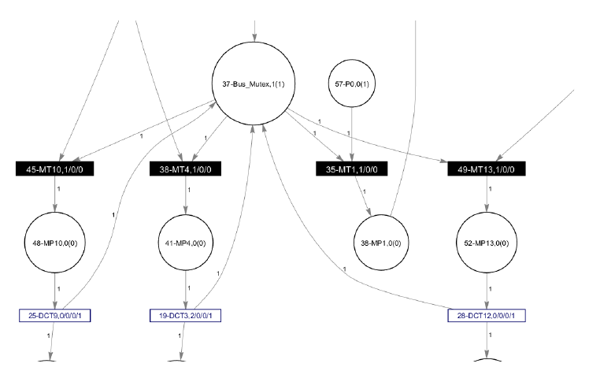
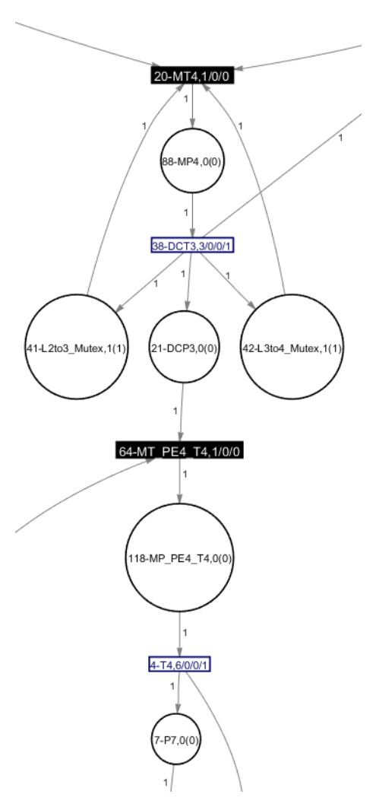

# Application Mapping on a Shared Bus vs a 4×4 Mesh NoC (Timed Petri Nets)

My final project for the Hardware/Software Co-Design course at the University of Kashan.
Sina Mozaffari Rad.

The question I wanted to answer: if I take one application and map its tasks onto 16 processing elements (PEs),
how much does the interconnect change the finish time? I compared a shared bus with a 4×4 mesh Network-on-Chip.
I modelled both with timed Petri nets in MATLAB, because a Petri net shows computation, communication and
resource conflicts in the same model, and you can see exactly where the time goes.

## The model

The application is a synchronous-dataflow-style graph that I turned into a timed Petri net with 16 computation
transitions and 18 places. Each transition is mapped to one of 16 PEs. Then I evaluated the same mapping on both
architectures, adding detail in three steps:

| Mo

**Bus.** Sixteen logical PEs on one shared bus. Communication between two different PEs costs 2 time units;
inside the same PE it costs nothing. In the final model, a `Bus_Mutex` place allows only one transfer on the bus
at a time, and each PE has its own mutex place.

**NoC.** A 4×4 mesh with XY routing. The communication delay is the Manhattan distance between the source and
destination PE. In the final model a transfer must reserve both PEs and every link on its XY path through mutex
places, so two transfers that need the same link have to wait for each other.

| Bus: one mutex for the whole bus | NoC: mutexes for the PEs and each link on the XY path |
| --- | --- |
|  |  |

## Results

One input token, with the transition-to-PE mapping from the report:

| Scenario | Finish time (time units) |
| --- | ---: |
| Computation only | 31 |
| Bus + communication delay | 35 |
| NoC + communication delay | 33 |
| Bus + PE and bus contention | 35 |
| NoC + PE and link contention | 37 |

When I added only the communication delays, the NoC was faster (33 vs 35), because many dependent tasks were
close to each other in the mesh. But once I modelled contention, my NoC mapping became slower than the bus
(37 vs 35). Some of my XY paths shared links, and those transfers had to wait.

So the result was not "NoC is better than a bus". With this mapping and only one token there is not much
parallel traffic, and the bus does not get overloaded. The NoC only wins when communicating tasks are placed
close together and when there is enough parallel communication to use its many links. For me, the main lesson
was that the mapping matters as much as the architecture.

## What I would try next

- Search for a better mapping automatically (for example simulated annealing on total hop count), instead of
  using one hand-made mapping.
- Run several tokens in a pipeline. I expect the NoC to pull ahead once there is more parallel traffic, but I
  have not tested it.
- Model router and buffer delay, not only link distance.

## Report

The full course report, with the modelling steps, simulator traces and Petri net figures:
[docs/final-project-report.pdf](docs/final-project-report.pdf).

## Files

```text
Bus/
  PN_Initial.m
  PN_BUS_DelayCommunication.m
  PN_BUS_FINAL.m
NOC/
  PN_Initial.m
  PN_NOC_DelayCommunication.m
  PN_NOC_FINAL.m
docs/
  final-project-report.pdf
assets/
  petri_bus_mutex.png
  petri_xy_route_pe4.png
```

## Running it

You need MATLAB and the course Petri net toolbox (`KU_PN_TOOL`), which provides `Init_PN`, `New_Place`,
`New_Transition`, `Weighted_Arc_P2T` and `Weighted_Arc_T2P`. The toolbox is from the course, not my code,
so it is not included here.

1. Add the toolbox and **one** of the `Bus` or `NOC` folders to the MATLAB path. Both folders have a function
   called `PN_Initial`, so adding both at once causes a name clash.
2. Run a model, for example:

   ```matlab
   model = PN_BUS_FINAL();
   ```

3. Simulate or plot the returned model with the toolbox.

To try a different mapping, change the transition-to-PE assignments at the top of the `.m` file. The
communication paths, delays and mutexes are generated from the mapping.
